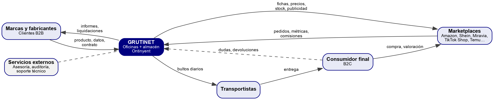

# 7.1. Presentación y caracterización de la empresa (B1)

**Grutinet S.L.** es una empresa de Ontinyent dedicada a la **gestión integral de marcas en marketplaces**. Las marcas y fabricantes le confían su producto y Grutinet se encarga de venderlo en las grandes plataformas de comercio electrónico (Amazon, Shein, Miravia, TikTok Shop, Temu, AliExpress, Carrefour, Privalia o Leroy Merlin). Para ello cubre todo el ciclo de venta, al que llama «venta 361°»: prepara el catálogo y las fichas de producto, fija y vigila los precios, gestiona la publicidad dentro de cada plataforma, almacena y envía los pedidos desde su propio almacén, atiende al cliente final y analiza los resultados para mejorarlos.

La empresa lleva más de dos décadas en el sector. Empezó como distribuidora y mayorista online, con servicio de dropshipping (envío directo al cliente de los pedidos que venden otras tiendas), y ha evolucionado hacia un modelo de agencia de servicios para marcas. Esta trayectoria explica por qué tiene logística propia, algo poco habitual en una agencia de marketing digital.

**Tabla 3.** Ficha de caracterización de Grutinet

| Dato | Valor | Fuente |
|---|---|---|
| Nombre | Grutinet (razón social: Grutinet S.L.) | Web corporativa; Empresia |
| Forma jurídica y CIF | Sociedad limitada · B97141410 | Empresia; einforma |
| Antigüedad | Constituida en 2001. Actividad desde 1999 según su perfil profesional; «más de dos décadas» según su web. | Empresia; LinkedIn; web |
| Sector | Terciario. Comercio electrónico y servicios de gestión de ventas en marketplaces. CNAE registrado: 4719 (otro comercio al por menor en establecimientos no especializados). | Empresia |
| Actividad principal | Gestión integral de la venta de marcas y fabricantes en marketplaces: catálogo, precios, publicidad, logística, atención al cliente y análisis. | Web (inicio y «Servicios») |
| Productos o servicios | Gestión de marketplaces, Paid Media, canales B2C, estrategia digital, logística (picking, packing, distribución, inventario), atención al cliente, reputación y expansión internacional. | Web («Servicios») |
| Sedes o centros | Un centro: P.I. L'Altet, C/ Els Caus 6, 46870 Ontinyent (Valencia), con oficinas, sala de reuniones y almacén logístico en el mismo recinto. No constan otras sedes. | Web («Sobre nosotros») |
| Trabajadores | Entre 21 y 26 personas, según los directorios consultados. LinkedIn la clasifica en el tramo de 11 a 50. | Empresia; directorios; LinkedIn |
| Tamaño | Pequeña empresa (menos de 50 trabajadores). Facturación aproximada de 2,5 M€ en 2024. | Empresia |
| Volumen de actividad | 133.666 bultos enviados en Shein y unos 439 envíos diarios (datos publicados hasta julio de 2025). Reconocida como «Best Seller en Shein Europa 2025». | Web («Servicios») |
| Tipo de clientes | B2B: marcas y fabricantes (cita a Babidu, Blindecor, Cerdá, Soler Hispania, Rubies y Warner Bros). De forma indirecta, el consumidor final (B2C) que compra en el marketplace. | Web («Ecosistema») |

## Relación con clientes, proveedores y otras entidades

Grutinet ocupa una posición intermedia entre las marcas y los marketplaces. La figura 1 resume sus relaciones y la información que circula en cada una:

- **Marcas y fabricantes (clientes):** envían el producto al almacén, los datos de catálogo (textos, imágenes, tarifas) y los objetivos comerciales. Reciben informes de ventas, liquidaciones y propuestas de mejora.
- **Marketplaces (canales de venta):** Grutinet publica en ellos las fichas, los precios, el stock y las campañas de publicidad. Cada plataforma le devuelve pedidos, comisiones y métricas de rendimiento del vendedor, y puede penalizarle si envía tarde o cancela pedidos.
- **Transportistas:** recogen a diario los bultos preparados en el almacén y los entregan al cliente final.
- **Consumidor final:** compra en el marketplace, valora el producto y el servicio y, si hay problemas, plantea dudas o devoluciones que atiende Grutinet.
- **Servicios externos:** asesoría, auditoría (en 2026 se nombró auditor) y, probablemente, soporte técnico informático.
- **Otras sedes:** no constan. Toda la actividad se concentra en Ontinyent.

*Figura 1. Relaciones de Grutinet con su entorno y la información que intercambia*

## Datos confirmados y supuestos

La web de Grutinet no publica su organización interna ni cómo trabaja por dentro. Lo que no se ha podido confirmar con una fuente se ha marcado como **supuesto** y se ha razonado:

**Tabla 4.** Supuestos de trabajo y su justificación

| Dato | Estado | Justificación |
|---|---|---|
| Sede única con oficinas y almacén | Confirmado | La web describe almacén, oficinas y sala de reuniones en la misma dirección. |
| Plantilla de unas 25 personas | Confirmado (rango) | Los directorios dan 21 y 26 personas. Se trabaja con unas 25. |
| Reparto de la plantilla por departamentos | Supuesto | Deducido de los servicios que ofrece: cada servicio necesita personas que lo hagan (ver B2). |
| Picos de trabajo en campañas (Black Friday, Navidad, Prime Day, rebajas) | Supuesto | Es habitual en el comercio electrónico. Implica más pedidos y, posiblemente, personal temporal en el almacén. |
| Teletrabajo parcial en perfiles de oficina | Supuesto | El trabajo de catálogo, publicidad y análisis se hace por completo en plataformas web. |
| Informática a cargo de una persona más soporte externo | Supuesto | Es lo habitual en una empresa de este tamaño. |
| Lectores o terminales móviles en el almacén | Supuesto | Con unos 440 envíos diarios y varias marcas, la preparación de pedidos sin lectores sería muy lenta y propensa a errores. |
