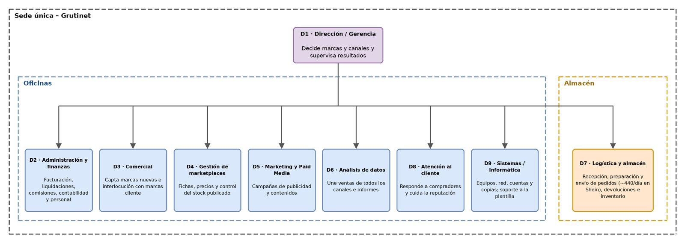

# 7.2. Organización interna y departamentos (B2)

## Departamentos identificados

Ninguna fuente pública describe la organización interna de Grutinet, así que los departamentos son una **propuesta razonada del grupo**. Hemos partido de los servicios que vende la empresa (B1): si ofrece catálogo, publicidad, logística, atención al cliente y análisis, alguien tiene que hacer cada una de esas tareas. A eso se suman las funciones que tiene cualquier empresa (dirección, administración e informática).

| # | Departamento | Por qué existe en Grutinet | Servicio o función del que sale |
|---|---|---|---|
| D1 | Dirección / Gerencia | Decide qué marcas y canales se trabajan y supervisa los resultados. | Función general de la empresa |
| D2 | Administración y finanzas | Factura a las marcas, cuadra las liquidaciones y comisiones de cada marketplace, paga y lleva la contabilidad y el personal. | Función general; relación con la asesoría y el auditor |
| D3 | Comercial | Capta marcas nuevas y es el interlocutor de cada marca cliente. | Clientes B2B (marcas y fabricantes) |
| D4 | Gestión de marketplaces | Crea y optimiza las fichas, fija y vigila los precios y controla el stock publicado en cada canal. | Gestión de marketplaces |
| D5 | Marketing y Paid Media | Lleva las campañas de publicidad dentro de las plataformas y los contenidos. | Paid Media y estrategia digital |
| D6 | Análisis de datos | Une las ventas de todos los canales y prepara informes para la dirección y las marcas. | Análisis de ventas |
| D7 | Logística y almacén | Recibe la mercancía, prepara y envía los pedidos (unos 440 al día solo en Shein) y gestiona devoluciones e inventario. | Logística propia; origen mayorista y de dropshipping |
| D8 | Atención al cliente | Responde a los compradores dentro de los plazos de cada marketplace y cuida la reputación. | Atención al cliente y reputación |
| D9 | Sistemas / Informática | Mantiene equipos, red, cuentas y copias, y da soporte a toda la plantilla. | Toda la actividad depende de plataformas digitales |

## Departamentos descartados o integrados

- **Recepción:** con una sede de unas 25 personas no justifica un departamento propio. Las visitas y llamadas las atiende Administración y finanzas (D2).
- **Vigilancia:** no consta personal propio. Si hace falta, sería un servicio externo (alarma y vigilancia del almacén).
- **Producción:** Grutinet no fabrica. Gestiona y envía producto de las marcas.

## Organigrama

La empresa tiene una **sede única** en Ontinyent con dos zonas: las **oficinas** y el **almacén**. La Dirección (D1) está por encima y de ella dependen directamente los otros ocho departamentos. Siete trabajan en las oficinas y Logística y almacén (D7) trabaja en el almacén.

**Figura 1.** Organigrama de Grutinet

| Zona | Departamentos |
|---|---|
| Dirección | D1 · Dirección / Gerencia |
| Oficinas | D2 · Administración y finanzas, D3 · Comercial, D4 · Gestión de marketplaces, D5 · Marketing y Paid Media, D6 · Análisis de datos, D8 · Atención al cliente, D9 · Sistemas / Informática |
| Almacén | D7 · Logística y almacén |

## Tabla de Organización y Análisis Funcional

*Grutinet S.L. — Estructura Departamental, Perfiles, Información y Comunicación Interdepartamental*

La tabla sigue los nueve departamentos del organigrama (D1-D9). En el primer borrador teníamos 13 departamentos. Al cerrar el organigrama los hemos agrupado así:

- **Financiero**, **Recursos Humanos** y **Administración** forman D2 · Administración y finanzas. Para unas 25 personas no hacen falta tres departamentos.
- **Compras**, **Importación** y **Exportación** se reparten entre D3 · Comercial (relación con las marcas, que son las que ponen el producto) y D7 · Logística y almacén (recepción de mercancía y envíos, también al extranjero).
- **Análisis de datos** pasa a ser un departamento propio (D6). Antes era un perfil dentro de Marketing.

**Tabla 5.** Departamentos de Grutinet: funciones, perfiles, información y comunicación

| # | Departamento | Función Principal | Perfiles Profesionales | Información que Maneja | Departamentos con los que se Comunica |
|---|---|---|---|---|---|
| D1 | Dirección / Gerencia | Definición de la estrategia corporativa: decide con qué marcas y canales se trabaja, toma las decisiones estratégicas y supervisa el cumplimiento de objetivos. | Director General, Adjunto a Dirección, Secretaría de Dirección. | Informes de rendimiento, cuadro de mando integral, planes estratégicos y presupuestos. | Con todos los departamentos de la organización. |
| D2 | Administración y finanzas | Facturación, liquidaciones y comisiones de cada marketplace, tesorería, contabilidad y cierres mensuales, gestión del personal (contratos, nóminas, control de presencia) y gestión documental y cumplimiento normativo. | Responsable de Administración y Finanzas, Contable, Técnico de RRHH, Auxiliar Administrativo. | Facturas emitidas/recibidas, liquidaciones de los marketplaces, datos de tesorería, previsiones de cobro/pago, expedientes de empleados, registros de jornada y documentación confidencial. | Con todos los departamentos (personal y facturación), sobre todo Dirección, Comercial y Atención al Cliente. |
| D3 | Comercial | Captar marcas nuevas (prospección del mercado B2B), ser el interlocutor de cada marca cliente y hacer el seguimiento de las grandes cuentas. | Director Comercial, Key Account Manager (KAM), Comercial de Ventas B2B. | Datos de las marcas cliente, pipeline de ventas, presupuestos comerciales, acuerdos y tarifas con las marcas. | Dirección, Marketplaces, Marketing, Análisis de datos, Administración y finanzas. |
| D4 | Gestión de marketplaces | Gestión multicanal y multimarca: crear y optimizar las fichas, fijar y vigilar los precios y controlar el stock publicado en cada canal. | Marketplace Manager, Especialista en E-commerce, Gestor de Catálogos. | Catálogos multimarca, precios, listings sincronizados, volumen de pedidos y métricas de plataforma. | Logística, Marketing, Atención al Cliente, Comercial, Sistemas. |
| D5 | Marketing y Paid Media | Campañas de publicidad dentro de las plataformas, contenidos y estrategia de marca, y análisis del retorno de la inversión (ROI). | Responsable de Marketing, Especialista en Paid Media, Creador de contenidos. | Métricas de las campañas, costes de adquisición (CPA) y presupuesto publicitario. | Marketplaces, Comercial, Análisis de datos, Dirección. |
| D6 | Análisis de datos | Unir las ventas de todos los canales y preparar informes para la dirección y para las marcas. | Analista de Datos. | Datos de ventas centralizados de todos los marketplaces, publicidad, stock e informes por marca. | Dirección, Comercial, Marketplaces, Marketing. |
| D7 | Logística y almacén | Recepción de mercancías, control de stock e inventario, almacenaje, preparación de pedidos (picking), expediciones (unos 440 al día solo en Shein, también envíos internacionales) y devoluciones. | Responsable de Logística, Mozos de Almacén, Carretilleros. | Consulta instantánea de stock, lecturas de código de barras, estados de expedición, albaranes y documentación de envíos al extranjero. | Marketplaces, Atención al Cliente, Comercial, Administración y finanzas. |
| D8 | Atención al cliente | Responder a los compradores dentro de los plazos de cada marketplace, gestionar incidencias, devoluciones y reclamaciones y cuidar la reputación. | Agentes de Atención al Cliente, Gestor de Incidencias. | Estado de pedidos en tiempo real, histórico de consultas, expedientes de incidencias y valoraciones. | Logística, Marketplaces, Comercial, Administración y finanzas. |
| D9 | Sistemas / Informática | Mantenimiento de equipos, red, cuentas de usuario y copias de seguridad, monitorización de los servicios y soporte técnico a toda la plantilla. | Responsable de Sistemas, Técnico de Soporte IT. | Registros de red, estado de los equipos y servicios, accesos de usuarios y copias de seguridad. | Transversal a todos los departamentos de la empresa. |

Versión maquetada en PDF (primer borrador, con 13 departamentos): [Tabla de organización B2](pdf/Tabla%20de%20organizaci%C3%B3n%20B2.pdf).
