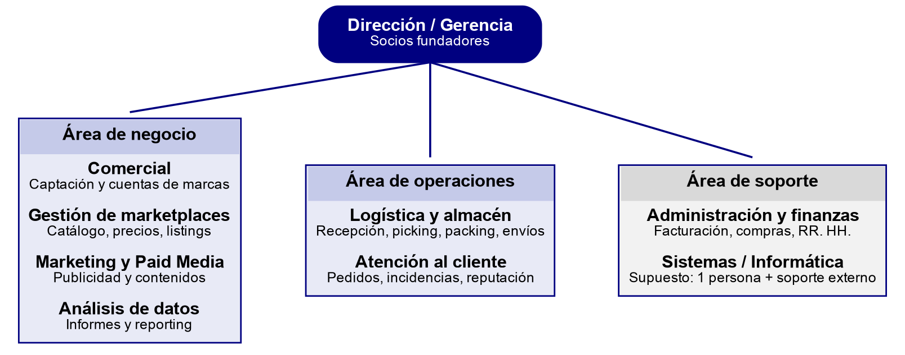

# 7.2. Organización interna y departamentos (B2)

Para identificar los departamentos hemos partido de los servicios que vende Grutinet: si la empresa ofrece catálogo, publicidad, logística, atención al cliente y análisis, alguien tiene que hacer cada una de esas tareas. A eso se suman las funciones que existen en cualquier empresa (dirección, administración e informática). El número de personas es una estimación coherente con una plantilla de unas 25.

**Tabla 5.** Departamentos de Grutinet: funciones, perfiles, información y comunicación

| Departamento | Función principal | Perfiles (n.º aprox.) | Información que maneja | Se comunica con |
|---|---|---|---|---|
| Dirección / Gerencia | Fijar la estrategia, decidir qué marcas y canales se trabajan y supervisar los resultados. | Socios fundadores y gerente (2) | Resultados económicos, contratos con marcas, indicadores de todos los departamentos. | Todos, en especial Administración, Comercial y Análisis. |
| Administración y finanzas | Facturación a marcas, liquidaciones de los marketplaces, pagos, contabilidad, compras y gestión del personal. | Responsable administrativo/a y auxiliar (2) | Facturas, cobros y pagos, comisiones, nóminas, datos personales de la plantilla. | Dirección, Comercial, Logística (compras y material), asesoría externa. |
| Comercial | Captar marcas nuevas, preparar propuestas y ser el interlocutor de cada marca cliente. | Key account managers (2) | Datos de contacto, propuestas, contratos, informes para la marca. | Dirección, Gestión de marketplaces, Análisis, Administración. |
| Gestión de marketplaces | Crear y optimizar fichas, fijar y vigilar precios, controlar el stock publicado y la Buy Box en cada canal. | Marketplace managers y técnicos/as de catálogo (5) | Catálogo de cada marca (textos, imágenes, EAN, tarifas), precios, stock publicado, cuentas de vendedor. | Comercial, Marketing, Logística, Atención al cliente, Análisis. |
| Marketing y Paid Media | Campañas de publicidad dentro de los marketplaces, contenidos y posicionamiento orgánico. | Especialistas en Paid Media y diseño (2) | Presupuestos, campañas, creatividades, rendimiento publicitario. | Gestión de marketplaces, Análisis, Comercial. |
| Análisis de datos | Unificar las ventas de todos los canales y preparar informes para la dirección y las marcas. | Analista de datos (1) | Ventas por marca y canal, márgenes, inversión publicitaria, métricas del vendedor. | Dirección, Comercial, Marketing, Gestión de marketplaces. |
| Logística y almacén | Recibir mercancía, ubicarla, preparar pedidos (picking y packing), entregar a transportistas y gestionar devoluciones e inventario. | Responsable de logística y mozos/as de almacén (7–8; más en campaña) | Stock por ubicación, pedidos pendientes, etiquetas de envío, devoluciones. | Gestión de marketplaces, Atención al cliente, Administración, transportistas. |
| Atención al cliente | Responder a compradores en los plazos de cada marketplace, gestionar incidencias y devoluciones y cuidar la reputación. | Agentes de atención al cliente (2–3) | Mensajes de compradores, estado de pedidos y envíos, incidencias, valoraciones. | Logística, Gestión de marketplaces, Comercial. |
| Sistemas / Informática | Mantener equipos, red, cuentas de usuario, copias de seguridad y soporte a la plantilla. | Técnico/a de sistemas (1) + soporte externo (supuesto) | Inventario de equipos, cuentas y permisos, incidencias técnicas. | Todos los departamentos. |

En total salen unas 24–26 personas, lo que cuadra con los datos públicos. Como no hay información sobre jerarquías intermedias, el organigrama (figura 2) agrupa los departamentos en tres áreas que dependen directamente de la dirección: **negocio** (lo que se vende y cómo se vende), **operaciones** (lo que pasa después de la venta) y **soporte** (lo que permite funcionar a toda la empresa).

*Figura 2. Organigrama de Grutinet (propuesta del grupo)*

El **flujo de un pedido** muestra cómo circula la información entre departamentos. El pedido entra en el marketplace y llega a Gestión de marketplaces y a Logística, que lo prepara y lo entrega al transportista. Si el comprador reclama, interviene Atención al cliente, que necesita saber en qué estado está el pedido. Al final, Análisis suma la venta a los informes y Administración la incluye en la liquidación de la marca. En cada paso varios departamentos consultan la misma información, y de ahí salen buena parte de las necesidades del bloque siguiente.
