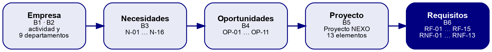

# 8. Resultados obtenidos

El resultado principal es el dossier del apartado 7. Para comprobar que es coherente se ha elaborado una **matriz de trazabilidad**, que une cada necesidad con su oportunidad, el elemento del proyecto que la resuelve y los requisitos que la cubren. La figura 3 resume esa cadena.

*Figura 3. Cadena de trazabilidad del dossier: de la empresa a los requisitos*

**Tabla 13.** Matriz de trazabilidad necesidad → oportunidad → elemento → requisito

| Nec. | Prior. | Oportunidad | Elemento del proyecto (B5) | Requisitos (B6) |
|---|---|---|---|---|
| N-01 | Alta | OP-02, OP-04 | Almacenamiento centralizado, servidores | RF-03, RF-04 |
| N-02 | Alta | OP-03, OP-04 | Aplicación web, base de datos, equipos cliente | RF-05, RF-06, RF-08, RNF-02, RNF-09, RNF-10 |
| N-03 | Alta | OP-05 | Red inalámbrica, equipos cliente | RF-06, RNF-08 |
| N-04 | Alta | OP-03 | Aplicación web, base de datos | RF-05, RF-07, RNF-09, RNF-10 |
| N-05 | Media | OP-04 | Base de datos, aplicación web | RF-08, RF-09 |
| N-06 | Alta | OP-01, OP-02 | Directorio, almacenamiento centralizado | RF-02, RF-03, RNF-07 |
| N-07 | Media | OP-09 | Acceso remoto seguro | RF-09, RF-10 |
| N-08 | Media | OP-02 | Almacenamiento centralizado | RF-03, RF-09 |
| N-09 | Alta | OP-07 | Monitorización | RF-11, RNF-11, RNF-12 |
| N-10 | Alta | OP-01, OP-06 | Directorio y autenticación centralizada | RF-01, RF-02, RNF-07 |
| N-11 | Alta | OP-06 | Segmentación (VLAN), red inalámbrica de invitados | RF-13, RNF-06 |
| N-12 | Alta | OP-08 | Copias de seguridad, CPD | RF-12, RNF-03, RNF-05 |
| N-13 | Alta | OP-08 | CPD con alimentación protegida | RNF-02, RNF-03, RNF-04 |
| N-14 | Media | OP-10 | Aplicación web, base de datos | RF-14, RNF-13 |
| N-15 | Media | OP-11 | Red LAN, todo el sistema | RNF-01, RNF-11 |
| N-16 | Baja | OP-03 | Aplicación web | RF-15 |

Con la matriz se han hecho tres comprobaciones:

- **Ninguna necesidad de prioridad alta se queda sin requisito.** Las 10 necesidades altas tienen al menos dos requisitos cada una.
- **Ningún requisito aparece sin una necesidad que lo justifique.** Los 15 RF y los 13 RNF citan al menos una necesidad.
- **Todos los elementos del proyecto (B5) aparecen en algún requisito.** Por ejemplo, el CPD en RNF-03 y RNF-04, y la segmentación en RNF-06.

# 9. Respuesta a las cuestiones planteadas

## 9.1. Pregunta final del reto

**Cuestión:** ¿podemos explicar claramente por qué nuestra empresa necesita este proyecto y qué requisitos debe cumplir?

**Respuesta (resumen de un minuto):** Sí. Grutinet es una pyme de Ontinyent con unas 25 personas que vende los productos de muchas marcas en nueve marketplaces y prepara unos 440 envíos diarios desde su propio almacén. Todo su negocio depende de que el stock, los pedidos y el catálogo estén al día, porque los marketplaces penalizan cada pedido tardío o cancelado. Hemos detectado 16 necesidades, 10 de ellas de prioridad alta: ver el stock y los pedidos en tiempo real, tener cobertura en toda la nave, controlar quién accede a cada dato, separar las redes, hacer copias de seguridad, resistir cortes y detectar fallos a tiempo. El Proyecto NEXO responde a ellas con un Sistema Informático Empresarial que debe cumplir 15 requisitos funcionales (cuenta única por persona, ficheros compartidos con permisos, aplicación de pedidos y stock, monitorización, copias…) y 13 no funcionales (disponibilidad en campaña, segmentación, confidencialidad, capacidad de crecimiento…). Cada requisito está ligado a una necesidad concreta.

## 9.2. ¿Por qué no se adelantan decisiones técnicas?

**Cuestión:** el enunciado prohíbe indicar marcas, modelos, direccionamiento o configuraciones. ¿Por qué?

**Respuesta:** porque en esta fase todavía se está definiendo **qué** necesita la empresa, no **cómo** se va a construir. Si eligiéramos ahora un producto concreto, estaríamos adaptando las necesidades a una solución, y no al revés. Además, esas decisiones dependen de factores que aún no se han estudiado (presupuesto, inventario, rendimiento, licencias) y que se trabajarán en los módulos técnicos. Por eso los requisitos de este dossier son medibles («responder en menos de 3 segundos», «recuperar cualquier día de las últimas cuatro semanas»), pero no dicen con qué tecnología se cumplirán.
